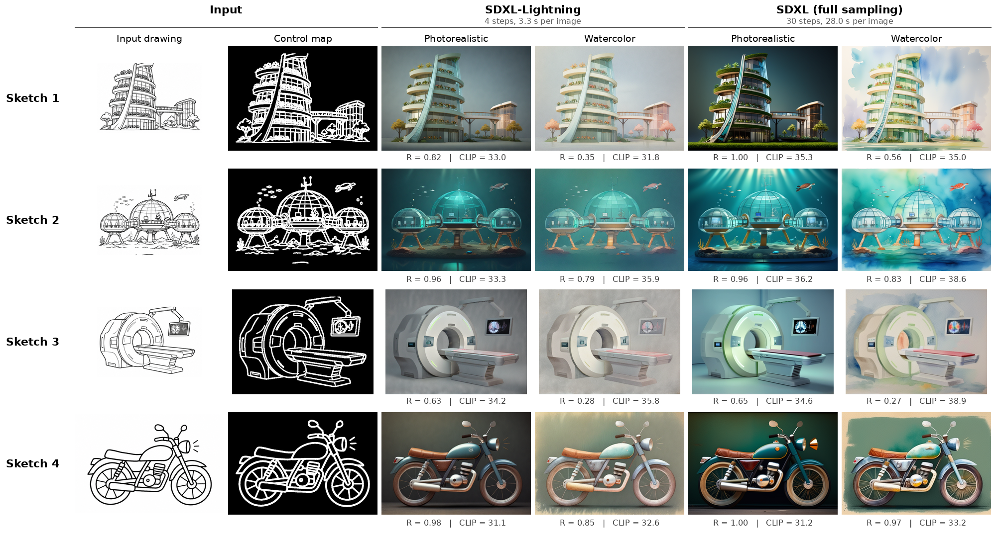
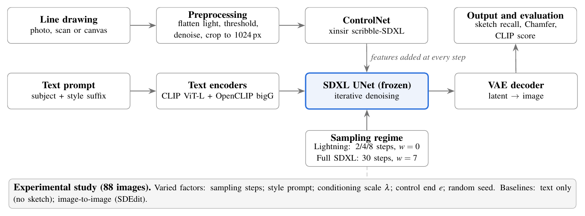
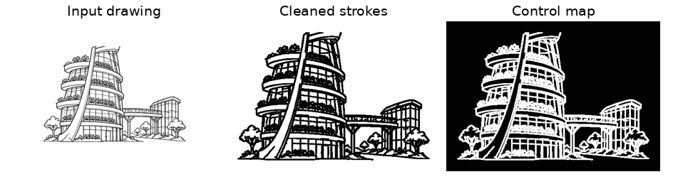
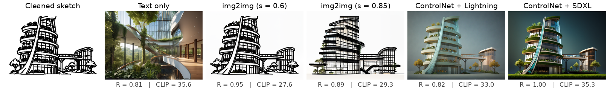
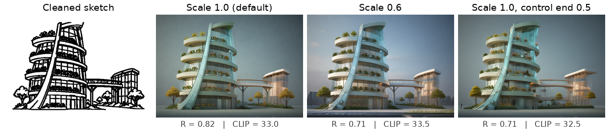
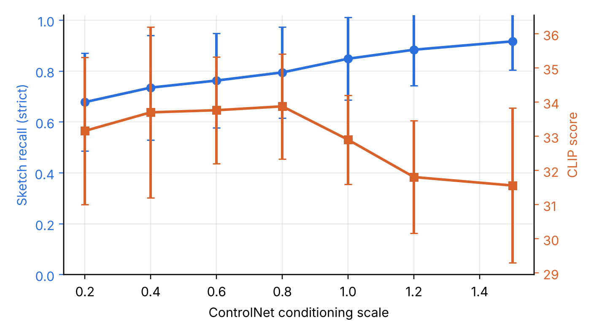
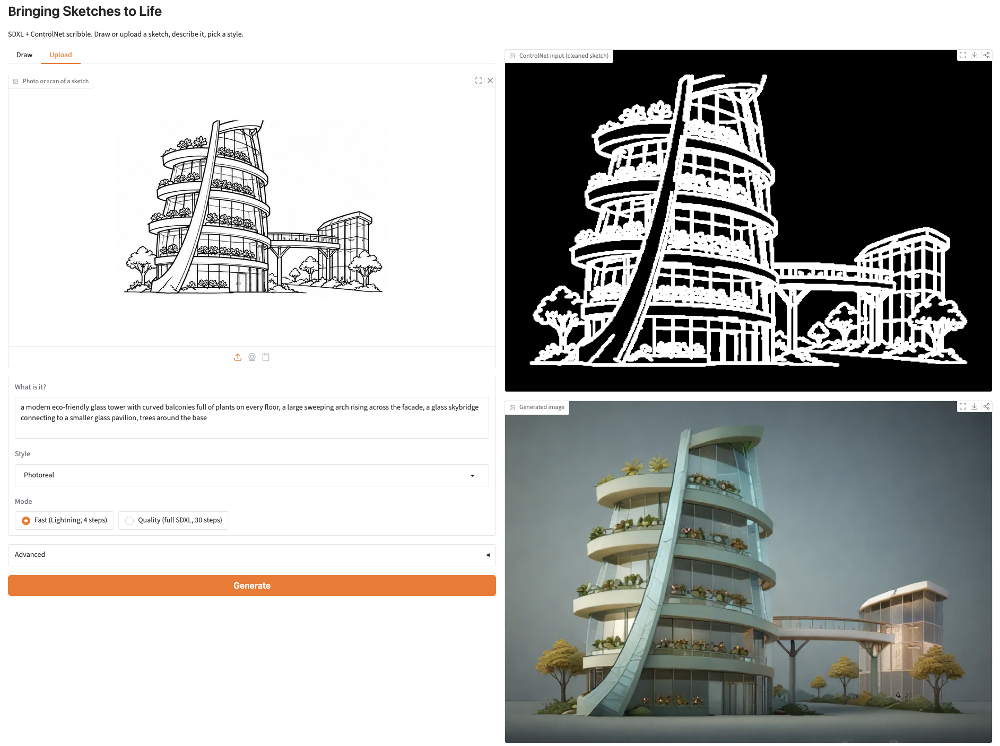

# Bringing Sketches to Life ✏️ → 🖼️
### Sketch-Conditioned Image Generation with SDXL and ControlNet: Distilled versus Full Sampling

**Natenaile Asmamaw Shiferaw** · Machine Learning and Computer Vision, Generative AI Project · Supervisor: Arezoo Ghodsifard

📄 **[Read the report (PDF)](Shiferaw_Sketch2Image_Report.pdf)** &nbsp;·&nbsp;
🎬 **[Watch the demo video](https://drive.google.com/file/d/1Up2tXEdKSTdNJ91mkKPbO_LScTOth5p0/view?usp=sharing)** &nbsp;·&nbsp;
🚀 **[Run it on Colab](notebooks/colab_demo.ipynb)**

This project turns line drawings into detailed images that keep the drawing's structure. **SDXL** is conditioned on the sketch through a **scribble ControlNet**, and a text prompt chooses the content and style. The project compares two ways of sampling the *same* model:

- ⚡ **SDXL-Lightning**, a distilled model: 4 steps, **3.3 s** per image
- 🎨 **Full SDXL**: 30 steps with classifier-free guidance, **28 s** per image

The question is how much structure and style control is lost when generation is **8.5× faster**.


<sub>**Four sketches, two sampling regimes, two styles.** Every output keeps the layout of its drawing. Full SDXL produces a convincing watercolor, while Lightning's watercolor looks like a faded photo. Below each image: sketch recall R and CLIP score.</sub>

---

## 🔍 Key results (Tesla T4, 4 sketches, 88 images)

| Method | Time / image | Sketch recall R ↑ | CLIP score ↑ |
|---|---|---|---|
| Text only (no sketch) | 19.2 s | 0.69 | 33.4 |
| img2img (SDEdit, s = 0.6) | 12.5 s | 0.98 | 29.3 *(still a line drawing)* |
| **ControlNet + SDXL-Lightning (4 steps)** | **3.3 s** | 0.85 | 32.9 |
| **ControlNet + full SDXL (30 steps)** | 28.0 s | **0.90** | **34.3** |

- **ControlNet is the only method that keeps the sketch *and* follows the prompt.**
- **Lightning keeps most of the structure but follows styles less strongly.** It runs without classifier-free guidance, so the CLIP gap is largest for watercolor (+2.4).
- **Conditioning scale λ = 0.8–1.0 gives the best balance.** Above that, prompt adherence drops.
- **Over-conditioning (strokes copied as outlines) did not occur** with SDXL and the xinsir ControlNet, so the default setting was best.

---

## 🧠 How it works



1. **Preprocessing:** a photo or scan of a drawing is turned into a clean white-on-black control map. The steps are illumination correction, adaptive threshold, speck removal, and resizing to 1024 px.

   

2. **Generation:** ControlNet reads the control map and adds its features to the frozen SDXL UNet at every denoising step. The sketch sets the *layout*; the prompt sets *materials, light and style*.
3. **Sampling:** one SDXL model, two regimes. **Lightning** loads the 2/4/8-step LoRA, uses an Euler sampler with trailing timesteps, and runs with no guidance. **Full SDXL** uses UniPC with 30 steps and guidance scale 7.
4. **Evaluation:**
   - **Sketch recall R:** the share of sketch strokes that reappear as edges in the image, within half a stroke width plus 0.5 % of the image size.
   - **Chamfer distance:** the mean distance in pixels from the strokes to the nearest edge.
   - **CLIP score:** how well the image matches the prompt.

### Prompts
Each prompt is a **subject description + style suffix**. For example:
> *"a classic retro motorcycle in side view, round headlight, teardrop fuel tank, flat leather seat, chrome exhaust pipe, finned engine, spoked wheels, parked on a street,* **professional photograph, realistic materials, natural light, highly detailed, sharp focus**"

| Style | Suffix |
|---|---|
| Photorealistic | professional photograph, realistic materials, natural light, highly detailed, sharp focus |
| Watercolor | watercolor painting, loose brush strokes, soft pastel washes, textured paper |
| Concept art | digital concept art, cinematic lighting, dramatic atmosphere, highly detailed |
| 3D render | 3D render, Blender, studio lighting, soft shadows, smooth materials |

All four subject descriptions are in [`configs/experiments.yaml`](configs/experiments.yaml).

---

## 🧪 Experiments

### Does the sketch matter? Baselines vs ControlNet

<sub>Without the sketch, the model invents a different scene. img2img keeps the drawing itself. ControlNet keeps the layout *and* renders realistic materials.</sub>

### Over-conditioning: can loosening the sketch help?

<sub>Lowering the scale (λ = 0.6) or stopping ControlNet halfway (e = 0.5) only reduced structure. The model starts adding its own content, such as a city skyline behind the tower.</sub>

### How strong should the sketch be?


<sub>Recall rises steadily with λ. Prompt adherence (CLIP) holds steady up to λ = 0.8, then drops.</sub>

### Speed vs quality

| Regime | Steps | Time (s) | Recall R | CLIP |
|---|---|---|---|---|
| SDXL-Lightning | 2 | 2.0 | 0.82 | 32.5 |
| SDXL-Lightning | **4** | **3.3** | **0.85** | 32.9 |
| SDXL-Lightning | 8 | 5.9 | 0.81 | 33.6 |
| Full SDXL | 30 | 28.0 | 0.90 | 34.3 |

All tables, with standard deviations, are in [`outputs/report/tables.md`](outputs/report/tables.md).

---

## 🖥️ Interactive app

Draw or upload a sketch, describe it, pick a style and **Fast** or **Quality** mode. The app shows the control map, the result and its sketch-recall score. 🎬 [Demo video](https://drive.google.com/file/d/1Up2tXEdKSTdNJ91mkKPbO_LScTOth5p0/view?usp=sharing)



```bash
python app.py --share     # prints a public gradio.live link (works from Colab)
```

---

## ⚙️ Reproduce

**Easiest:** open [`notebooks/colab_demo.ipynb`](notebooks/colab_demo.ipynb) in Google Colab, select a **T4 GPU**, and run the cells. It takes about 40 minutes, including about 10 GB of model downloads.

**Locally** (CUDA GPU with at least 12 GB):
```bash
pip install -r requirements.txt
python tests/test_preprocess_metrics.py        # CPU sanity check, no downloads
python run_experiments.py --preprocess-only    # check the cleaned sketches
python run_experiments.py                      # all experiments (resumes if interrupted)
python run_experiments.py --recompute-metrics  # re-score saved images, rebuild figures/tables (no GPU)
```
Settings: fp16, 1024 px, seed 42. The experiment plan is in `configs/experiments.yaml`. Settings, time and metrics for every image are in `outputs/all_results.csv`.

### Repository structure
```
├── app.py                     # Gradio web app
├── run_experiments.py         # runs all experiments, writes figures + tables
├── configs/experiments.yaml   # sketch descriptions, styles, experiment settings
├── sketch2image/
│   ├── preprocess.py          # drawing → control map
│   ├── pipeline.py            # SDXL + ControlNet, Lightning LoRA adapters, baselines
│   ├── metrics.py             # sketch recall / precision / Chamfer, CLIP score
│   └── viz.py                 # report figures
├── notebooks/colab_demo.ipynb # one-click reproduction on Colab
├── sketches/                  # the four input drawings
├── tests/                     # CPU tests for preprocessing and the metric
└── outputs/                   # figures, tables, per-image results
```

---

## 📚 References

**Models (Hugging Face):** [SDXL base 1.0](https://huggingface.co/stabilityai/stable-diffusion-xl-base-1.0) · [SDXL VAE fp16-fix](https://huggingface.co/madebyollin/sdxl-vae-fp16-fix) · [xinsir ControlNet scribble SDXL](https://huggingface.co/xinsir/controlnet-scribble-sdxl-1.0) · [SDXL-Lightning](https://huggingface.co/ByteDance/SDXL-Lightning) · [CLIP ViT-B/32](https://huggingface.co/openai/clip-vit-base-patch32)

**Libraries:** [diffusers](https://github.com/huggingface/diffusers), [transformers](https://github.com/huggingface/transformers), [peft](https://github.com/huggingface/peft), PyTorch, [Gradio](https://github.com/gradio-app/gradio), OpenCV, scikit-image, pandas, matplotlib.

**Papers:** Podell et al., *SDXL*, ICLR 2024 · Zhang, Rao & Agrawala, *ControlNet*, ICCV 2023 · Lin, Wang & Yang, *SDXL-Lightning*, arXiv:2402.13929 · Rombach et al., *Latent Diffusion*, CVPR 2022 · Ho & Salimans, *Classifier-Free Guidance*, 2022 · Meng et al., *SDEdit*, ICLR 2022 · Zhao et al., *UniPC*, NeurIPS 2023 · Hu et al., *LoRA*, ICLR 2022 · Radford et al., *CLIP*, ICML 2021 · Hessel et al., *CLIPScore*, EMNLP 2021. The full list is in the [report](Shiferaw_Sketch2Image_Report.pdf).

**AI assistance:** an AI assistant (Claude, Anthropic) was used to support code development and to edit the report. The author ran all experiments and is responsible for the results.
